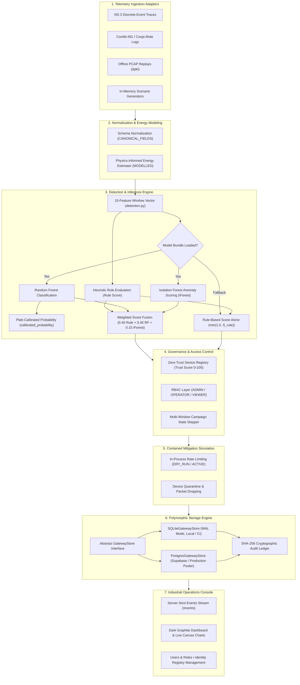

# AI-Based Cyber Security Gateway for Industry 4.0 (AICG)

[](https://www.python.org/)
[](https://flask.palletsprojects.com/)
[](https://gunicorn.org/)
[](https://scikit-learn.org/)
[](https://www.postgresql.org/)
[](https://github.com/kbandla/dpkt)
[]()
[]()
[](LICENSE)

An edge cybersecurity gateway research prototype engineered for Industrial IoT (IIoT) and Industry 4.0 operational technology (OT) networks. The platform unites multi-source telemetry ingestion, deterministic physics-informed energy and resource modeling, hybrid machine learning anomaly detection, dynamic Zero-Trust Identity and Access Management (IAM), multi-window campaign correlation, closed-loop incident lifecycle governance, and enterprise user management within an industrial Matte Graphite operations console.

---

## 1. Project Overview

**AI-Based Cyber Security Gateway for Industry 4.0 (AICG)** (internally designated **Aegis Gateway**) is an edge cybersecurity research prototype and demonstrator engineered to evaluate defense mechanisms for resource-constrained field networks (such as 6LoWPAN, Modbus/TCP, and MQTT) against DDoS-style traffic anomalies and modeled network/resource exhaustion behaviors.

The demonstrator processes normalized telemetry events, in-process simulated scenario windows, and offline PCAP/NS-3/Cooja traces within a software evaluation pipeline. It does **not** passively sniff physical network interfaces or operate as an inline bump-in-the-wire hardware gateway between physical OT devices and SCADA/MES systems. Instead, it evaluates a logical/simulated plant architecture: correlating telemetry event velocity with modeled edge energy dissipation, identifying anomalous attack vectors through hybrid machine learning and heuristic rules, and demonstrating closed-loop mitigation within strict in-process software containment (`DRY_RUN`).

---

## 2. Dashboard Preview


*Figure 1: AICG Industrial Security Operations Console — Real-time telemetry monitoring, Zero-Trust device trust tracking, and containment controls.*

---

## 3. Problem Statement

Modern Industry 4.0 deployments exhibit critical cybersecurity vulnerabilities at the OT edge:

1. **Severe Resource Asymmetry**: Edge field devices (sensors, actuators, RTUs) operate under strict energy and memory budgets (e.g., MSP430, ARM Cortex-M), rendering cryptographic handshakes and heavy endpoint security agents impractical.
2. **Stealthy Volumetric & Pulsing DDoS**: Attackers leverage compromised IoT nodes to conduct low-rate pulsing and multi-vector UDP/ICMP floods that degrade deterministic control loops without exceeding static firewall volume thresholds.
3. **Energy Depletion ("Sleep Deprivation") Attacks**: Malicious packet storms force battery-powered edge motes to remain in high-power radio listen/transmit states, exhausting multi-year battery reserves in hours.
4. **False Positive Operational Risk**: In industrial automation, erroneously blocking legitimate telemetry from safety-critical sensors can interrupt critical processes and trigger unscheduled plant shutdowns.
5. **Operational Accountability & Role-Based Governance**: Industrial control systems require strict administrative role separation, identity registries, credential auditing, and immutable event logging to satisfy Zero-Trust standards.

---

## 4. Proposed Solution & Architecture

The **Aegis Gateway** evaluates defense-in-depth edge protection across a logical/simulated industrial network architecture:

```
+-----------------------------------------------------------------------------------------+
|                    Logical / Simulated Industrial Plant Architecture                    |
|       [Modeled 6LoWPAN Motes] --> [Aegis Gateway Core] --> [Logical SCADA/MES]          |
|       (Offline PCAPs / In-Memory Windows / NS-3 Discrete-Event Traces)                 |
+-----------------------------------------------------------------------------------------+
                                             |
         +-----------------------------------+-----------------------------------+
         |                                   |                                   |
         v                                   v                                   v
[Modeled Energy Estimator]      [Hybrid ML & Rule Engine]           [Zero-Trust IAM & RBAC]
Deterministic mW modeling        Random Forest + Isolation Forest    Dynamic Device Trust (0..100)
(Mathematical estimator)         + Platt Calibration + Rules         RBAC: ADMIN / OPERATOR / VIEWER
         |                                   |                                   |
         +-----------------------------------+-----------------------------------+
                                             |
                                             v
                              [Campaign Lifecycle Correlator]
                              5-Stage Sequential Incident Stepper
                              (DETECTED -> CONTAINED -> INVESTIGATING -> RECOVERING -> RESOLVED)
                                             |
                                             v
                              [Polymorphic Dual-Storage Engine]
                              SQLite3 (WAL Mode, Local / CI)
                              PostgreSQL (Supabase, Session Pooler, TLS)
                              SHA-256 Tamper-Evident Audit Ledger
                                             |
                                             v
                              [Industrial Graphite Operations HMI]
                              Locally hosted, Server-Sent Events (/events),
                              Canvas Historian Charts, Identity Registry
```

### End-to-End System Processing Pipeline



---

## 5. Key Features

- **Multi-Source Ingestion Pipeline**: Ingests normalized telemetry events from multiple ingestion adapters, including offline NS-3 discrete-event traces, Contiki-NG / Cooja mote logs, standard PCAP replays (via `dpkt`), and in-process scenario generators through a unified canonical schema (`CANONICAL_FIELDS`).
- **Physics-Informed Energy & Resource Modeling**: Generates deterministic, physics-informed, `MODELLED` energy and resource estimates (quiescent and active power dissipation in mW, window energy in mJ, and modeled CPU, memory, and radio duty-cycle metrics) derived from observed packet velocity, protocol complexity, and packet-size efficiency. Functions strictly as a mathematical estimator and is **not** a hardware power meter.
- **Hybrid Machine Learning & Heuristic Detection**: Combines heuristic rule evaluation, a supervised Random Forest classifier reporting Platt-calibrated attack probabilities, and an Isolation Forest for out-of-distribution anomaly scoring.
- **Calibrated Attack Probability vs. Fused DDoS Risk Metric**: Accurately differentiates the Platt-calibrated attack probability (`calibrated_probability`, mapped to the circular AI Threat Confidence gauge) from the multi-tier fused DDoS risk score (`decision.score` / `latest_ddos_probability`, mapped to Card 2).
- **Strict Claim & Provenance Discipline**: All metrics, charts, and audit records explicitly declare their operational provenance (`SIMULATED`, `SYNTHETIC`, `MODELLED`, `REPLAYED`, `DERIVED`), ensuring synthetic metrics are never misrepresented as physical readings.
- **Dynamic Zero-Trust Identity & Access Management (IAM)**: Evaluates dynamic trust scores ($0 \dots 100$) per device identity based on operational behavior: maintaining baseline yields a delta of 0, suspicious traffic detection applies a delta of -20, observed recovery toward baseline awards +3, and authentication failure imposes -15. Access authorization is denied when a device trust score falls below the 40-point policy threshold.
- **Enterprise Admin User Management & Identity Registry**: Full administrative user management via `/api/admin/users`, supporting user creation, role assignment (`ADMIN`, `OPERATOR`, `VIEWER`), administrator-initiated password resets, self-demotion protection, last-admin deletion guards, and mandatory password changes on temporary credentials.
- **Role-Based Access Control (RBAC) & Protected Session Handling**: Fine-grained authorization enforcing permissions (`MANAGE_USERS`, `MANAGE_INCIDENT`, `CLOSE_INCIDENT`, `ADMIN_CONTROLS`, `ACK_ALERT`, `VIEW_AUDIT`). Client-side credentials have zero exposure in frontend scripts; manual credential entry is enforced for administrative accounts.
- **Multi-Window Incident Campaign Correlation**: Correlates successive high-rate attack bursts from the same origin into unified campaign incidents across a 5-stage sequential lifecycle stepper, preventing alert floods and ensuring reproducible incident forensics.
- **Contained Software Mitigation Simulation**: Defaults to `DRY_RUN` mode. When configured for `ACTIVE` or `ENFORCING` operation, mitigations (token-bucket rate limiting, in-process stream drops, and simulated device quarantine) affect events strictly inside the application's in-process telemetry pipeline, with zero installation of host firewall rules (`iptables`, `nftables`, `pf`) or physical network interface manipulation.
- **Cryptographic Audit Historian**: Records administrative actions, authentication events, user modifications, policy transitions, and alert dismissals in an append-oriented, SHA-256 hash-chained audit ledger with database-level locking and tamper detection.
- **Polymorphic Dual-Database Persistence**: Supports embedded SQLite with WAL mode for zero-dependency local runs and automated testing, alongside managed PostgreSQL (Supabase with session connection pooling and SSL) for durable cloud deployment.
- **Production Cloud Deployment Readiness**: Container-ready and optimized for Render web service hosting using Gunicorn `gthread` concurrency (16 worker threads, 120s timeout, keep-alive) and Server-Sent Events (SSE) coalescing.
- **Industrial Matte Graphite UI**: Locally hosted industrial operations console featuring dark graphite design tokens, tabular numerals, real-time Canvas streaming charts updated via SSE (`/events`), and zero external CDN dependencies.

---

## 6. AI/ML Detection Engine & Threat Metrics

The gateway computes rolling 1-second statistical feature windows from normalized ingress telemetry.

### Detection Feature Vector (15 Features)
Defined in `backend/aegis_gateway/detection.py` (`FEATURES` and `feature_mapping`), the inference pipeline extracts a 15-dimensional numerical float vector per evaluation window:

| # | Feature Identifier | Explanation |
| :-: | :--- | :--- |
| 1 | `packet_count` | Observed packet count in the window (`float`, minimum 1.0) |
| 2 | `byte_count` | Total bytes transferred across the window (`float`) |
| 3 | `packet_rate` | Packet velocity in packets per second (`float`) |
| 4 | `byte_rate` | Data transfer velocity in bytes per second (`float`) |
| 5 | `unique_sources` | Count of distinct source IP addresses in window (`float`) |
| 6 | `unique_destinations` | Count of distinct destination IP addresses in window (`float`) |
| 7 | `packet_size` | Average packet size in bytes across window (`float`) |
| 8 | `udp_ratio` | Binary protocol indicator: 1.0 if protocol is UDP, else 0.0 |
| 9 | `tcp_ratio` | Binary protocol indicator: 1.0 if protocol is TCP, else 0.0 |
| 10 | `icmp_ratio` | Binary protocol indicator: 1.0 if protocol is ICMP or ICMPv6, else 0.0 |
| 11 | `syn_ratio` | Binary flag indicator: 1.0 if TCP SYN flag is present, else 0.0 |
| 12 | `flow_count` | Flow count derived from unique sources (`float`, minimum 1.0) |
| 13 | `cpu_activity` | Modeled edge device CPU utilization percentage (`float`) |
| 14 | `memory_activity` | Modeled edge device memory utilization percentage (`float`) |
| 15 | `energy_deviation` | Relative energy rate deviation from baseline (`float`, can be negative) |

### Hybrid Inference Pipeline & Score Fusion
The `HybridDetector` engine in `backend/aegis_gateway/detection.py` combines deterministic heuristics with trained machine learning estimators:

1. **Feature Vector Mapping**: Ingress telemetry events are transformed into 15 scalar floats via `feature_mapping(event)`.
2. **Rule-Based Heuristic Evaluation**: Evaluates threshold conditions (such as high packet rate surges, source IP expansion, SYN flag observation, and concurrent energy deviation) to compute a bounded heuristic score ($S_{\text{rule}} \in [0.0, 1.0]$) and generate human-readable explainability evidence. When no trained model bundle is loaded, this rule engine remains fully operational as an autonomous fallback (`MODEL_VERSION = "rules-v2-untrained"`).
3. **Supervised Classification & Platt Calibration**: When a model bundle is loaded, a Random Forest estimator computes class probabilities. When trained with `CalibratedClassifierCV(method="sigmoid")`, the Platt-scaled attack probability is exposed as `calibrated_probability`.
4. **Outlier Anomaly Scoring**: An `IsolationForest` estimator measures tree-path isolation depth using `decision_function`, which is mapped to a bounded anomaly score ($S_{\text{iForest}} \in [0.0, 1.0]$) to capture out-of-distribution patterns without relying on geometric distance.
5. **Weighted Score Fusion**: When a model bundle is loaded, the final decision score combines heuristic rules and ML estimators:
   $$\text{Score} = \min(1.0,\; 0.40 \cdot S_{\text{rule}} + 0.45 \cdot S_{\text{RF}} + 0.15 \cdot S_{\text{iForest}})$$
   If no model bundle is loaded, the score is determined solely by heuristic rules ($\text{Score} = \min(1.0, S_{\text{rule}})$). A window triggers an attack state when $\text{Score} \ge 0.50$.

### Metric Precision: Threat Confidence vs. DDoS Risk Index

The gateway dashboard maintains strict mathematical separation between its two primary risk indicators:

- **Circular AI Threat Confidence Gauge (Platt-Calibrated)**:
  - **Data Source**: `decision.calibrated_probability` (extracted from the ML classifier's calibrated probability distribution).
  - **Semantics**: True statistical probability ($0.0 \dots 1.0$) that current traffic represents an active attack. Under normal baseline OT conditions, this metric reports nominal values (~1%, rendered in Cyan). Under active attack vectors, it scales to 99%–100% (rendered in Red). If uncalibrated or unavailable, it renders an unasserted state (`"—"` in muted gray).
- **DDoS Risk Index (Card 2)**:
  - **Data Source**: `decision.score` / `latest_ddos_probability` (the multi-tier fused risk score).
  - **Semantics**: Fused engineering threat index ($0.0 \dots 1.0$) combining heuristic rules ($40\%$), Random Forest ($45\%$), and Isolation Forest ($15\%$). Accompanied by categorical classification tags (`CLEAR`, `SUSPICIOUS`, `CRITICAL`).

---

## 7. DDoS Simulation & Offline Trace Methodology

The project incorporates both in-process synthetic telemetry generation for real-time console demonstration and offline discrete-event/mote simulation tools for research dataset generation.

### In-Process Telemetry Scenario Generator (11 Profiles)
The scenario generator (`backend/aegis_gateway/scenarios.py`) produces simulated `TelemetryEvent` objects entirely in memory for interactive evaluation.

> [!IMPORTANT]
> **Safe In-Process Telemetry Generation**: In-process scenarios generate simulated `TelemetryEvent` objects entirely in memory; they **never transmit network packets** over physical or virtual network interfaces.

- **1 Normal Baseline Profile:**
  - `normal`: "Normal IIoT rhythm" — In-memory periodic baseline telemetry profile modeling nominal operational activity and quiescent energy dissipation.
- **10 Modeled Anomaly Profiles:**
  1. `udp_flood`: High-rate UDP datagram burst profile with elevated simulated packet velocity.
  2. `syn_flood`: Modeled TCP SYN-heavy profile with elevated SYN flag presence; does not cause actual network connection-table exhaustion.
  3. `icmp_flood`: Modeled ICMP-heavy profile with elevated ICMP indicator; does not disrupt physical control systems.
  4. `burst_exhaustion`: Short, intermittent high-intensity modeled bursts designed to stimulate the modeled energy dissipation calculator.
  5. `slow_rate`: Low-frequency modeled TCP connection profile representing persistent resource pressure without exceeding volumetric thresholds.
  6. `coap_anomaly`: Simulated CoAP-style protocol profile (UDP destination port 5683); does not perform actual CoAP parsing or packet transmission.
  7. `mqtt_anomaly`: Simulated MQTT/MQTT-SN-style burst profile (TCP destination port 1883); does not require or exhaust an actual MQTT message broker.
  8. `rpl_anomaly`: Simulated RPL/6LoWPAN control-plane anomaly profile (ICMPv6); does not decode RPL frames or induce actual routing loops.
  9. `modbus_anomaly`: Simulated industrial Modbus-style query profile (TCP destination port 502); does not parse Modbus payloads or cause actual RTU exhaustion.
  10. `mixed_vector`: Multi-protocol hybrid profile alternating between modeled UDP, TCP, and ICMP windows.

### Server-Side Path Traversal Hardening (CodeQL Verified)
All PCAP and trace file ingestion endpoints (`/api/traces/import`, `/api/traces/replay`) enforce server-side path traversal protection:
- Filenames are strictly constrained against an approved allowlist.
- Paths are resolved to their canonical representations via `os.path.realpath()` and verified to reside strictly within designated trace directories.
- Any attempt to access unauthorized paths or escape directory boundaries is rejected with HTTP 400/403.

### Offline Discrete-Event & Sensor OS Simulation (NS-3 & Cooja)
In addition to the in-process scenario generator, the project utilizes external simulation frameworks to produce realistic network capture traces for offline evaluation, detailed in [backend/simulation/README.md](backend/simulation/README.md):
- **Custom NS-3 C++ Discrete-Event Models**: Standalone C++ simulation models (`backend/simulation/ns3/ddos_udp*.cc` and `backend/simulation/normal_iiot.cc`) written against the NS-3 Network Simulator (tested with NS-3.48 under GNU GPLv2).
- **PCAP Trace Generation and dpkt Ingestion**: Executing NS-3 simulations generates standard `.pcap` capture files. The gateway's adapter engine (`backend/aegis_gateway/adapters.py`) decodes these offline traces using `dpkt 1.9.8` (BSD-3-Clause) to reproduce network event streams for ingestion without live packet replay.
- **Contiki-NG / Cooja Mote Simulation**: Cooja simulator traces capture low-power wireless 6LoWPAN mote radio duty-cycles and energy consumption logs.

---

## 8. Zero-Trust IAM, RBAC & Enterprise User Management

### Dynamic Device Trust Scoring
The gateway evaluates device identities registered in `backend/aegis_gateway/iam.py`:
- Device identities (`SENSOR-01` to `SENSOR-03`, `ATK-01`, etc.) maintain a continuous trust score ($0 \dots 100$).
- Trust scoring adjustments:
  - Nominal Baseline Activity: $\Delta = 0$
  - Suspicious Traffic Observed: $\Delta = -20$
  - Observed Baseline Recovery: $\Delta = +3$
  - Authentication or Policy Failure: $\Delta = -15$
- **Access Authorization Boundary**: When a device's trust score drops below the 40-point threshold, access is denied and subsequent telemetry is dropped.

### Role-Based Access Control (RBAC)
The gateway enforces a three-tier RBAC model across all REST endpoints and WebSocket/SSE event streams:

| Role | Operational Scope | Assigned Permissions |
| :--- | :--- | :--- |
| **`ADMIN`** | Full security operations, system administration, and user management | `VIEW_DASHBOARD`, `VIEW_INCIDENTS`, `VIEW_SECURITY_POSTURE`, `VIEW_SYSTEM_STATUS`, `VIEW_AUDIT`, `ACK_ALERT`, `MANAGE_INCIDENT`, `CLOSE_INCIDENT`, `ADMIN_CONTROLS`, `MANAGE_USERS` |
| **`OPERATOR`** | Incident handling, simulation controls, and alert triage | `VIEW_DASHBOARD`, `VIEW_INCIDENTS`, `VIEW_SECURITY_POSTURE`, `VIEW_SYSTEM_STATUS`, `VIEW_AUDIT`, `ACK_ALERT`, `MANAGE_INCIDENT`, `ADMIN_CONTROLS` |
| **`VIEWER`** | Read-only observation of security posture and telemetry | `VIEW_DASHBOARD`, `VIEW_INCIDENTS`, `VIEW_SECURITY_POSTURE`, `VIEW_SYSTEM_STATUS` |

### Enterprise User Management & Identity Registry
The administrative console includes a dedicated **Users & Roles • Identity Registry** supporting complete lifecycle governance:
- **REST Endpoints**:
  - `GET /api/admin/users`: Enumerate all registered console accounts with metadata (User ID, username, role, MFA status, password change status, creation timestamp).
  - `POST /api/admin/users`: Provision a new console operator with role assignment and temporary credentials.
  - `PUT /api/admin/users/<user_id>`: Modify existing user roles and permissions.
  - `DELETE /api/admin/users/<user_id>`: Delete user accounts with complete audit logging.
  - `POST /api/admin/users/<user_id>/reset-password`: Flag account for mandatory password reset.
  - `POST /api/auth/change-password`: Restricted session endpoint for mandatory password updates.
- **Protective Invariants**:
  - **Self-Demotion Guard**: An active administrator cannot demote or delete their own session.
  - **Last-Admin Guard**: The system refuses deletion or demotion of the final remaining `ADMIN` account.
  - **Mandatory Password Change Workflow**: Users provisioned with temporary credentials or flagged by an admin are routed to a restricted mandatory password update view before console access is granted. New passwords must be at least 8 characters and cannot match the temporary password.
- **Interactive Modals**: The UI provides dedicated, accessible modal dialogs for User Creation, Role Editing, Password Reset, and Deletion Confirmation.

### Demonstration & Production Authentication
- **Demonstration Accounts (Development Mode)**:
  - `admin`: Full administrative access. (Password is protected; manual entry required).
  - `operator1` (`Operator@AICG2026!`): Pre-configured operator account with quick-fill assistance in development mode.
- **Simulated Multi-Factor Authentication (MFA)**:
  - Implements a simulated two-stage MFA verification workflow (`123456`) with a progressive-disclosure drawer.
  - Strictly an educational simulation for protocol demonstration; not a production TOTP/FIDO2 hardware authenticator.

---

## 9. Incident Lifecycle & Contained Mitigation

### 5-Stage Sequential Incident Stepper
Incidents advance through an explicit, sequential state machine driven by canonical backend state:

```
[NORMAL] ──► [DETECTED] ──► [CONTAINED] ──► [INVESTIGATING] ──► [RECOVERING] ──► [RESOLVED]
```

1. **`DETECTED`**: Ingress traffic window exceeds decision threshold ($\text{Score} \ge 0.50$). An incident record is created and linked to the anomalous device.
2. **`CONTAINED`**: Software-level containment policy is applied (rate limiting or quarantine).
3. **`INVESTIGATING`**: Operator acknowledges alerts and reviews explainability context, energy deviations, and flow patterns.
4. **`RECOVERING`**: Attack traffic ceases; device demonstrates verified consecutive normal observation windows.
5. **`RESOLVED`**: Normal baseline is sustained across consecutive evaluation cycles; incident is formally closed.

### Mitigation Policies & Software Containment Boundary
- **Mitigation Modes**:
  - `DRY_RUN` (Default): Evaluates policies and logs containment actions without dropping telemetry.
  - `ACTIVE` / `ENFORCING`: Applies in-process token-bucket rate limiting (`RATE_LIMIT`), telemetry dropping (`DROP`), and device quarantine (`QUARANTINE`).
- **In-Process Boundary**: All mitigation occurs strictly inside the application's Python event pipeline. The gateway does **not** modify host OS routing tables, physical network interfaces, or kernel firewall rules (`iptables`, `nftables`, `pf`).

---

## 10. Administrative Audit Logging & Integrity

The gateway maintains an append-oriented, tamper-evident audit ledger in table `admin_audit_log`:
- **Cryptographic Hash Chaining**: Every record computes an immutable SHA-256 hash chaining its contents with the preceding entry:
  $$\text{record\_hash} = \text{SHA-256}(\text{prev\_hash} \parallel \text{event\_id} \parallel \text{timestamp} \parallel \text{username} \parallel \text{action} \parallel \text{resource} \parallel \text{result} \parallel \text{details})$$
- **Genesis Anchor**: The root block links to a verified genesis constant (`GENESIS_HASH = "0" * 64`).
- **Concurrency & Transaction Safety**: Audit insertions are guarded by re-entrant process locks (`_audit_lock`) and database-level transaction locks (`BEGIN IMMEDIATE` in SQLite, advisory locking in PostgreSQL) to prevent hash-chain forks during concurrent events.
- **Tamper Detection**: An automated integrity verification routine scans the ledger from genesis to latest record, verifying hash links and flagging discontinuities.

> [!NOTE]
> **Architectural Status**: The proposed Dual-Epoch Audit Ledger redesign is currently postponed. The production gateway actively operates the verified single-chain SHA-256 tamper-evident ledger.

---

## 11. Persistence & Database Architecture

AICG implements a polymorphic **Dual-Storage Engine** (`backend/aegis_gateway/storage.py`):

```
┌─────────────────────────────────────────────────────────────────────────────┐
│                       AICG Relational Database Schema                       │
└─────────────────────────────────────────────────────────────────────────────┘
  ┌──────────────────┐           ┌──────────────────┐
  │    admin_users   │           │   device_identities│
  ├──────────────────┤           ├──────────────────┤
  │ user_id (PK)     │           │ device_id (PK)   │
  │ username (UQ)    │           │ identity         │
  │ password_hash    │           │ trust_score      │
  │ role             │           │ authenticated    │
  │ must_change_pwd  │           │ revoked          │
  └─────────┬────────┘           └─────────┬────────┘
            │                              │
  ┌─────────▼────────┐           ┌─────────▼────────┐
  │  admin_audit_log │           │   trust_history  │
  ├──────────────────┤           ├──────────────────┤
  │ seq_id (PK)      │           │ id (PK)          │
  │ prev_hash        │           │ device_id (FK)   │
  │ record_hash      │           │ trust_score      │
  │ timestamp        │           │ delta            │
  └──────────────────┘           └──────────────────┘
            │                              │
  ┌─────────▼────────┐           ┌─────────▼────────┐
  │    incidents     │◄──────────┤    telemetry     │
  ├──────────────────┤           ├──────────────────┤
  │ incident_id (PK) │           │ seq_id (PK)      │
  │ lifecycle_state  │           │ timestamp        │
  │ severity         │           │ packet_rate      │
  │ recovery_state   │           │ ddos_probability │
  └─────────┬────────┘           └──────────────────┘
            │                              │
  ┌─────────▼────────┐           ┌─────────▼────────┐
  │ incident_history │           │     actions      │
  └──────────────────┘           └──────────────────┘
```

### Relational Schema (11 Tables & 13 Performance Indexes)
1. `telemetry`: High-frequency streaming network flow metrics with composite indexes on `(timestamp DESC, seq_id DESC)` and `(protocol)`.
2. `incidents`: High-level operational security incidents with full state machine lifecycle.
3. `incident_history`: Audit trail tracking state transitions, actors, timestamps, and causal evidence.
4. `actions`: Mitigation and containment decisions mapped to incidents.
5. `iam_events`: Zero-Trust identity access attempts, authentication checks, and role evaluations.
6. `trust_history`: Continuous dynamic device trust scores ($0 \dots 100$) and delta changes.
7. `metadata`: Key-value gateway configuration, schema versions, and runtime flags.
8. `admin_users`: User credentials, password salts/hashes, roles, MFA states, and password change flags.
9. `admin_alerts`: Real-time system notifications and alerts for operators.
10. `admin_audit_log`: Immutable security audit log with cryptographic SHA-256 hash chaining.
11. `device_identities`: OT hardware fingerprints, authorized protocols, and device metadata.

### Storage Engines
- **`SQLiteGatewayStore` (Default)**: Embedded SQLite3 with Write-Ahead Logging (`WAL`), `NORMAL` synchronous mode, foreign key enforcement, and a 5,000ms busy timeout. Optimized for zero-dependency local development and automated CI.
- **`PostgresGatewayStore` (Production)**: Activated when `DATABASE_URL` is configured. Connects to managed PostgreSQL (e.g., Supabase Session Pooler on port 5432 over IPv4 with `sslmode=require`) using `psycopg2` threaded connection pooling. Includes advisory locking (`AICG_USER_MUTATION_ADVISORY_LOCK_ID`) for mutation safety.

---

## 12. Technology Stack

| Layer | Component | Version | Operational Role |
| :--- | :--- | :--- | :--- |
| **Language** | Python | 3.14.8 | Primary backend runtime environment |
| **Web Runtime** | Flask | 3.1.3 | REST API endpoints, SSE event streams, template rendering |
| | Werkzeug | 3.1.9 | WSGI utilities, secure cookie policies, request handling |
| **WSGI Server** | Gunicorn | 23.0.0 | Multi-threaded WSGI application server (`gthread`) |
| **Data & ML** | scikit-learn | 1.9.0 | Random Forest, Isolation Forest, CalibratedClassifierCV |
| | NumPy | 2.5.2 | Vector transformations, numeric matrices |
| | SciPy | 1.18.0 | Scientific computing routines |
| | Pandas | 3.0.5 | Dataset manipulation and CSV processing |
| **Packet Engine**| dpkt | 1.9.8 | PCAP frame parsing (Ethernet, PPP, RAW IP, TCP/UDP/ICMP) |
| **Persistence** | SQLite3 | Embedded | WAL-mode metrics historian and local audit ledger |
| | PostgreSQL | 15+ / Cloud | Production relational database (Supabase Session Pooler) |
| | psycopg2-binary | 2.9.10 | PostgreSQL database adapter and connection pooling |
| **Frontend** | Pure HTML5 / CSS3 / ES6 | Native | Locally hosted industrial console with Canvas charts and zero external CDN dependencies |
| **Simulation** | NS-3 Network Simulator | 3.48 | Discrete-event IIoT network topology and traffic simulation |
| | Contiki-NG / Cooja | Not pinned | 6LoWPAN mote operating system emulation and trace extraction |
| **Testing** | pytest | 9.1.1 | Automated unit, regression, security, and integration suites |
| | Typeguard | 4.6.0 | Runtime type validation for security-critical functions |
| **CI / Automation**| GitHub Actions | v7 | Automated multi-version continuous integration workflow |
| | Dependabot | Active | Automated dependency vulnerability monitoring |

---

## 13. Dashboard Screenshots & Demonstrations

### 1. Network Topology (Normal Baseline State)

*Figure 2: Normal Baseline State — Simulated dashboard visualization displaying modeled legitimate sensor nodes reporting nominal telemetry to gateway and PLC sink.*

### 2. Network Topology (Under Attack State)

*Figure 3: Topology View Under Attack — Simulated console display illustrating distributed attacker nodes generating multi-vector traffic anomalies with active visual alert indications.*

### 3. Alert & Incident Lifecycle Management

*Figure 4: Alert and Incident Lifecycle Panel — Sequential multi-window incident correlation tracking attacks from detection to contained mitigation.*

### 4. Operator Attack Simulator Cockpit

*Figure 5: Operator Attack Cockpit — Interactive vector control panel under strict dry-run software containment.*

---

## 14. Installation and Setup

### Prerequisites
- **Operating System:** Linux (tested on Kali Linux x86_64, Ubuntu 24.04 LTS)
- **Python Version:** Python 3.12+ (tested on Python 3.14.8)
- **Database:** SQLite3 (embedded default) or PostgreSQL 15+
- **Version Control:** Git

### Clone the Repository
```bash
git clone https://github.com/jaydeepm25/AI-Based-Cyber-Security-Gateway-AICG.git
cd AI-Based-Cyber-Security-Gateway-AICG
```

### Virtual Environment Setup
```bash
# Create an isolated Python virtual environment
python3 -m venv .venv

# Activate the virtual environment
source .venv/bin/activate
```

### Dependency Installation
```bash
# Upgrade pip to latest release
pip install --upgrade pip

# Install core runtime dependencies
pip install -r requirements.txt

# Install testing and development dependencies
pip install -r requirements-dev.txt
```

---

## 15. Running the Application

### Development / Demonstration Mode (Default)
By default, the gateway operates in development mode (`AEGIS_PRODUCTION=0`) with demonstration accounts enabled for local evaluation:

```bash
# Launch the gateway application using Flask's development server
python3 dashboard/app.py
```

The gateway console will be accessible at:
```text
http://127.0.0.1:8000
```

#### Demonstration Credentials
- **Administrator**: `admin` (Password protected; manual entry required)
- **Operator**: `operator1` / `Operator@AICG2026!` (Quick-fill button available in login view)
- **Simulated MFA Code**: `123456`

### Production Configuration Mode
In production mode (`AEGIS_PRODUCTION=1`), demonstration accounts are suppressed, default lab keys are rejected, and the gateway enforces fail-fast credential validation on startup:

```bash
# Mandatory Production Environment Variables
export AEGIS_PRODUCTION=1
export AEGIS_SECRET_KEY="<strong-random-session-secret-key-at-least-32-chars>"
export AEGIS_MASTER_KEY="<strong-random-device-master-key-at-least-32-chars>"
export AEGIS_INITIAL_ADMIN_USERNAME="admin"
export AEGIS_INITIAL_ADMIN_PASSWORD="<strong-initial-admin-password>"

# Optional: Cloud PostgreSQL persistence (Supabase Session Pooler)
export DATABASE_URL="postgresql://postgres.<ref>:<pass>@aws-0-<region>.pooler.supabase.com:5432/postgres?sslmode=require"

# Launch with production Gunicorn WSGI server
gunicorn --workers 1 --threads 16 --worker-class gthread --timeout 120 --keep-alive 5 --bind 0.0.0.0:8000 dashboard.app:app
```

### Render Cloud Deployment
The repository includes production configuration for hosting on **Render**:
- **Procfile**:
  ```procfile
  web: gunicorn --workers 1 --threads 16 --worker-class gthread --timeout 120 --keep-alive 5 --bind 0.0.0.0:$PORT backend.app:app
  ```
- **Concurrency Profile**: 16 `gthread` worker threads allocated to accommodate persistent SSE client connections (`/events`) without starving REST API endpoints.
- **Database Routing**: Configured to connect to Supabase PostgreSQL via the IPv4 Session Pooler on port 5432 with SSL enabled.

---

## 16. Testing and Verification

The repository includes a comprehensive automated test suite verifying security controls, cryptographic token caching, API boundary enforcement, ML model inference, user management CRUD, PostgreSQL storage operations, and dpkt PCAP parsing.

### Verified Test Execution
- **Test Result:** **481 passed, 11 skipped** (100% pass rate for executed suite)
- **Total Test Cases:** **492 tests collected**
- **Execution Time:** **121.06 seconds**
- **Verification Commit:** `3148748`
- **Verification Date:** 27 November 2026
- **Test Environment:** Linux (x86_64), Python 3.14.8, pytest 9.1.1, typeguard 4.6.0
- *(Note: The 11 skipped tests comprise `test_postgres_integration.py`, which cleanly skips when an isolated live PostgreSQL database URL is not exported via `TEST_DATABASE_URL`).*

### Continuous Integration (CI)
Automated testing is configured via GitHub Actions (`.github/workflows/tests.yml`), running the test suite across commits and pull requests against Python 3.14.

### Running the Test Suite
```bash
# Run the complete test suite
pytest

# Run tests with summary output
pytest -q

# Run specific test modules
pytest backend/tests/test_detection_and_ml.py
pytest backend/tests/test_api_and_runtime.py
pytest backend/tests/test_admin_security_layer.py
pytest backend/tests/test_user_management_api.py
pytest backend/tests/test_postgres_storage_unit.py
```

---

## 17. Repository Structure

```
AI-Based-Cyber-Security-Gateway-AICG/
├── .github/
│   ├── dependabot.yml                  # Dependabot automated dependency security configuration
│   └── workflows/
│       └── tests.yml                   # GitHub Actions automated test workflow
├── .gitignore                          # Tailored Python, ML, NS-3, and frontend exclusion rules
├── .python-version                     # Python runtime version declaration
├── LICENSE                             # MIT Open-Source License (Gateway Application)
├── Procfile                            # Gunicorn WSGI production deployment definition
├── README.md                           # Master technical project documentation
├── THIRD_PARTY_NOTICES.md              # Verified third-party software licenses and notices
├── pytest.ini                          # Test runner and warning filter configuration
├── requirements.txt                    # Core runtime dependencies
├── requirements-dev.txt                # Development and test runner dependencies
├── dashboard/                          # Standalone dashboard launcher (app.py)
├── data -> backend/data                # Root compatibility symlink to database storage
├── dataset -> backend/dataset          # Root compatibility symlink to research datasets
├── models -> backend/models            # Root compatibility symlink to ML models
├── simulation -> backend/simulation    # Root compatibility symlink to NS-3 models
├── backend/
│   ├── app.py                          # Flask application launcher
│   ├── aegis_gateway/                  # Core gateway Python package
│   │   ├── adapters.py                 # dpkt PCAP, NS-3, and Cooja trace parsing
│   │   ├── api.py                      # REST endpoints, SSE streams, RBAC, user management API
│   │   ├── config.py                   # Environment settings and fail-fast validation
│   │   ├── detection.py                # 15-dimensional ML feature extraction and HybridDetector
│   │   ├── energy.py                   # Deterministic physics-informed energy and resource model
│   │   ├── iam.py                      # Zero-Trust device registry, trust scoring, and RBAC
│   │   ├── ml.py                       # Random Forest, Isolation Forest, and dataset generator
│   │   ├── policy.py                   # Contained mitigation engine (DRY_RUN rate-limiting)
│   │   ├── runtime.py                  # Thread-safe in-process simulation loop coordinator
│   │   ├── scenarios.py                # Scenario definitions (1 normal + 10 anomaly profiles)
│   │   ├── schema.py                   # Canonical schema definitions and field normalization
│   │   ├── security.py                 # Password hashing, session tokens, simulated MFA
│   │   └── storage.py                  # SQLite / PostgreSQL dual-storage engine and audit logging
│   ├── dataset/                        # Simulation PCAPs, feature CSVs, and Cooja logs (Rights Reserved)
│   │   └── README.md                   # Dataset provenance and non-permissive terms
│   ├── models/                         # Calibrated ML bundles (Joblib) (Rights Reserved)
│   │   └── README.md                   # Model provenance and non-permissive terms
│   ├── reports/
│   │   ├── evidence/screenshots/       # High-resolution UI acceptance screenshots
│   │   └── srs/                        # Software Requirements Specifications & diagrams
│   ├── scripts/                        # Automated browser test and verification scripts
│   ├── simulation/
│   │   ├── README.md                   # NS-3 simulation models documentation (GPLv2)
│   │   ├── normal_iiot.cc              # Baseline NS-3 IIoT simulation model (GPLv2)
│   │   └── ns3/                        # Custom C++ NS-3 DDoS simulation scripts (GPLv2)
│   └── tests/                          # Automated pytest verification suite (492 tests)
├── docs/                               # Architecture blueprints, migration audits, health reports
└── frontend/
    ├── README.md                       # Frontend architecture and UI guidelines
    ├── static/
    │   ├── css/
    │   │   └── dashboard.css           # High-contrast Matte Graphite design tokens
    │   └── js/
    │       └── dashboard.js           # Real-time SSE subscriber, Canvas renderers, user management
    └── templates/
        ├── attacker.html               # Attack simulation console template
        ├── index.html                  # Operator / Admin security dashboard & User Management modal
        └── login.html                  # Login, simulated MFA, and mandatory password change template
```

---

## 18. Security and Limitations

### Security Architecture Disclosures
1. **Simulated Multi-Factor Authentication (MFA)**:
   The current implementation uses simulated MFA with a fixed demonstration token (`123456`) for user-interface step-up authentication. It is strictly an educational simulation and does **not** provide production-grade TOTP, FIDO2, or WebAuthn hardware integration.
2. **Response Modes and In-Process Containment**:
   - **Default Mode (`DRY_RUN`)**: Evaluates mitigation policies and logs planned containment actions without modifying event streams.
   - **In-Process Telemetry Mitigation (`ACTIVE` / `ENFORCING`)**: Mitigation policies (token-bucket rate limiting, in-process stream filtering, simulated device quarantine) affect events strictly inside the application's in-process telemetry pipeline.
   - **No Physical Network Enforcement**: No mode installs host kernel firewall rules (`iptables`, `nftables`, `pf`), modifies system routing tables, or controls physical network interfaces.
3. **Research & Demonstration Gateway**:
   AICG is designed as a cybersecurity engineering research platform and demonstration gateway for Industry 4.0 evaluation. It is **not** a production-hardened operating system firewall or host intrusion prevention system.
4. **Audit Ledger Design**:
   The audit log operates as a verified single-chain SHA-256 tamper-evident ledger with database-level concurrency locking. The Dual-Epoch redesign remains a future roadmap item.
5. **Production Credential Provisioning**:
   Switching an existing database from development to production mode does not automatically delete previously seeded demonstration accounts. Administrators must audit user records via the Identity Registry or provision a clean database.

---

## 19. Roadmap

- [x] **GitHub Actions CI**: Automated regression test suite execution across commits and pull requests.
- [x] **Dependabot Security Updates**: Automated dependency vulnerability scanning and PR generation.
- [x] **Cloud Database Persistence**: Dual-engine support for managed PostgreSQL (Supabase) alongside embedded SQLite.
- [x] **Enterprise User Management**: Administrative user CRUD, RBAC, self-demotion guards, and mandatory password reset workflows.
- [x] **Production WSGI Concurrency**: Multi-threaded Gunicorn deployment profile optimized for long-lived SSE connections.
- [ ] **Hardware-Backed FIDO2 / WebAuthn MFA**: Upgrade simulated MFA to hardware security keys (YubiKey / WebAuthn).
- [ ] **Dual-Epoch Cryptographic Audit Ledger**: Implement distinct epoch-based checkpointing for historical archives and active operational chains.
- [ ] **eBPF / XDP Data-Plane Acceleration**: In-kernel packet filtering for volumetric flood mitigation at high line rates.
- [ ] **Hardware Security Module (HSM) Integration**: Bind Zero-Trust device token cryptographic keys and audit hashes to physical TPM 2.0 or secure elements.
- [ ] **P4 Programmable Industrial Switch Pipeline**: Compile gateway policy rules into P4 runtime definitions for multi-gigabit industrial Ethernet hardware.
- [ ] **Federated Edge Learning**: Enable privacy-preserving collaborative model weight training across multiple distributed plant gateways.

---

## 20. Contributors and Acknowledgements

Developed as an advanced cybersecurity engineering platform for resilient Industry 4.0 edge automation.

**Author & Copyright Holder:** JAYDEEP JOTIRAM MULIK

Special thanks to:
- The **NS-3 Project** for discrete-event network simulation frameworks.
- The **Contiki-NG & Cooja Communities** for 6LoWPAN low-power wireless emulation tools.
- The **scikit-learn, NumPy, SciPy, and Pandas Teams** for foundational scientific computing libraries.
- The **dpkt Development Team** for lightweight PCAP frame parsing tools.

---

## 21. Licensing and Intellectual Property

**Copyright (c) 2026 JAYDEEP JOTIRAM MULIK**

The AICG repository incorporates distinct licensing boundaries across its components:

### 1. Gateway Application Source Code (MIT License)
The original Python backend source code in `backend/aegis_gateway/`, user interface assets in `frontend/`, maintenance scripts in `backend/scripts/`, and automated test suites in `backend/tests/` are licensed under the standard [MIT License](LICENSE).

### 2. NS-3 Network Simulation Models (GNU GPLv2)
The custom C++ simulation programs in `backend/simulation/ns3/` (`ddos_udp*.cc`) and `backend/simulation/normal_iiot.cc` are developed against NS-3 Network Simulator API headers. In accordance with NS-3 upstream licensing requirements, these simulation components are governed by the **GNU General Public License version 2 (GPL-2.0-only)**. See [backend/simulation/README.md](backend/simulation/README.md).

### 3. Simulation Datasets and Pre-Trained Machine Learning Models
The synthetic IIoT telemetry datasets, feature CSV files, and raw PCAP packet captures in `backend/dataset/`, as well as pre-trained model bundles in `backend/models/` (`realistic_detector_v1.joblib` and `hybrid_detector.joblib`), are strictly excluded from the root MIT License. They are **not** licensed under CC0-1.0, CC-BY, MIT, or any other open-source license, and no additional reuse permission is granted. All rights are reserved by the copyright holder (JAYDEEP JOTIRAM MULIK). See [backend/dataset/README.md](backend/dataset/README.md) and [backend/models/README.md](backend/models/README.md).

### 4. Third-Party Open-Source Components
All third-party libraries, frameworks, and tools (including Flask, Werkzeug, scikit-learn, NumPy, Joblib, dpkt, psycopg2, Gunicorn, and pytest) remain licensed under their respective upstream open-source licenses (BSD-3-Clause, MIT, and Apache-2.0). Complete verified dependency notices, copyright declarations, and license terms are detailed in [THIRD_PARTY_NOTICES.md](THIRD_PARTY_NOTICES.md).
