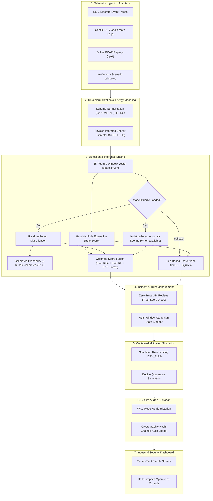

# AI-Based Cyber Security Gateway for Industry 4.0 (AICG)

[](https://www.python.org/)
[](https://flask.palletsprojects.com/)
[](https://scikit-learn.org/)
[](https://github.com/kbandla/dpkt)
[]()
[]()
[](LICENSE)

An edge cybersecurity gateway research prototype engineered for Industrial IoT (IIoT) and Industry 4.0 operational technology (OT) networks. The platform unites multi-source telemetry ingestion, deterministic physics-informed energy and resource modeling, hybrid machine learning anomaly detection, dynamic Zero-Trust Identity and Access Management (IAM), multi-window campaign correlation, and closed-loop incident lifecycle governance within an industrial Matte Graphite operations console.

---

## 1. Project Overview

**AI-Based Cyber Security Gateway for Industry 4.0 (AICG)** (internally designated **Aegis Gateway**) is an edge cybersecurity research prototype and demonstrator engineered to evaluate defense mechanisms for resource-constrained field networks (such as 6LoWPAN, Modbus/TCP, and MQTT) against DDoS-style traffic anomalies and modeled network/resource exhaustion behaviors.

The demonstrator processes normalized telemetry events, in-process simulated scenario windows, and offline PCAP/NS-3/Cooja traces within a software evaluation pipeline. It does **not** passively sniff physical network interfaces or operate as an inline bump-in-the-wire hardware gateway between physical OT devices and SCADA/MES systems. Instead, it evaluates a logical/simulated plant architecture: correlating telemetry event velocity with modeled edge energy dissipation, identifying anomalous attack vectors through hybrid machine learning and heuristic rules, and demonstrating closed-loop mitigation within strict in-process software containment (`DRY_RUN`).

---

## 2. Dashboard Preview


*Figure 1: AICG Industrial Security Operations Console — Real-time telemetry monitoring, Zero-Trust device trust tracking, and containment controls.*

---

## 3. Problem Statement

Modern Industry 4.0 deployments exhibit critical cybersecurity vulnerabilities at the OT edge:

1. **Severe Resource Asymmetry**: Edge field devices (sensors, actuators, RTUs) operate under strict energy and memory budgets (e.g., MSP430, ARM Cortex-M), rendering cryptographic handshakes and heavy endpoint security agents impractical.
2. **Stealthy Volumetric & Pulsing DDoS**: Attackers leverage compromised IoT nodes to conduct low-rate pulsing and multi-vector UDP/ICMP floods that degrade deterministic control loops without exceeding static firewall volume thresholds.
3. **Energy Depletion ("Sleep Deprivation") Attacks**: Malicious packet storms force battery-powered edge motes to remain in high-power radio listen/transmit states, exhausting multi-year battery reserves in hours.
4. **False Positive Operational Risk**: In industrial automation, erroneously blocking legitimate telemetry from safety-critical sensors can interrupt critical processes and trigger unscheduled plant shutdowns.

---

## 4. Proposed Solution

The **Aegis Gateway** evaluates defense-in-depth edge protection across a logical/simulated industrial network architecture:

```
+-------------------------------------------------------------------------------+
|             Logical / Simulated Industrial Plant Architecture                 |
|   [Modeled 6LoWPAN Motes] --> [Aegis Gateway Core] --> [Logical SCADA/MES]    |
|   (Offline PCAPs / In-Memory Windows / NS-3 Discrete-Event Traces)           |
+-------------------------------------------------------------------------------+
                                       |
        +------------------------------+------------------------------+
        |                              |                              |
        v                              v                              v
[Modeled Energy Estimator] [Hybrid ML & Rule Engine]     [Zero-Trust IAM & RBAC]
Deterministic mW modeling   RF (Calibrated if flagged)    Trust score (0..100)
(Not a hardware meter)      + iForest / Rule Fallback     Access denied below trust threshold (40)
        |                              |                              |
        +------------------------------+------------------------------+
                                       |
                                       v
                         [Campaign Lifecycle Correlator]
                         Sequential Multi-Stage Stepper
                         (NORMAL -> DETECTED -> MITIGATED)
                                       |
                                       v
                         [Industrial Graphite Operations HMI]
                         Locally hosted, tabular numerals,
                         Server-Sent Events UI updates
```

---

## 5. Key Features

- **Multi-Source Ingestion Pipeline**: Ingests normalized telemetry events from multiple ingestion adapters, including offline NS-3 discrete-event traces, Contiki-NG / Cooja mote logs, standard PCAP replays (via dpkt), and in-process scenario generators through a unified canonical schema (`CANONICAL_FIELDS`).
- **Physics-Informed Energy & Resource Modeling**: Generates deterministic, physics-informed, MODELLED energy and resource estimates (quiescent and active power dissipation in mW, window energy in mJ, and modeled CPU, memory, and radio duty-cycle metrics) derived from observed packet velocity, protocol complexity, and packet-size efficiency. The module functions explicitly as a deterministic mathematical estimator and is **not** a physical hardware power meter.
- **Hybrid Machine Learning & Heuristic Detection**: Employs rule-based heuristic checks, a Random Forest classifier (reporting Platt-calibrated probabilities when a calibrated bundle is loaded), and an Isolation Forest for out-of-distribution anomaly scoring.
- **Strict Claim & Provenance Discipline**: All metrics, charts, and audit records explicitly declare their operational provenance (`SIMULATED`, `SYNTHETIC`, `MODELLED`, `REPLAYED`, `DERIVED`), ensuring synthetic metrics are never misrepresented as physical readings.
- **Dynamic Zero-Trust Identity & Access Management (IAM)**: Evaluates dynamic trust scores ($0 \dots 100$) per device identity based on operational behavior: maintaining the normal baseline yields a delta of 0, suspicious traffic detection applies a delta of -20, observed recovery toward baseline awards a delta of +3, and authentication failure imposes a delta of -15. Access authorization is denied when a device trust score falls below the 40-point policy threshold.
- **Multi-Window Incident Campaign Correlation**: Correlates successive high-rate attack bursts from the same origin into unified campaign incidents, preventing alert floods and ensuring reproducible incident forensics.
- **Contained Software Mitigation Simulation**: Defaults to `DRY_RUN` mode. When configured for `ACTIVE` or `ENFORCING` operation, mitigations (token-bucket rate limiting, in-process stream drops, and simulated device quarantine) affect events strictly inside the application's in-process telemetry pipeline, with zero installation of host firewall rules (`iptables`, `nftables`, `pf`) or physical network interface manipulation.
- **Cryptographic Audit Historian**: Records administrative actions, authentication events, policy transitions, and alert dismissals in an append-oriented, cryptographically hash-chained audit ledger with an integrity verification routine.
- **Industrial Matte Graphite UI**: Locally hosted industrial operations console featuring a dark graphite UI with tabular numerals, real-time Canvas streaming charts updated via Server-Sent Events (SSE), and no external CDN dependencies.

---

## 6. System Architecture

The end-to-end data processing and mitigation lifecycle operates across seven coordinated subsystems:



---

## 7. Technology Stack

| Layer | Component | Version | Operational Role |
| :--- | :--- | :--- | :--- |
| **Language** | Python | 3.14.8 | Primary backend runtime environment |
| **Web Runtime** | Flask | 3.1.3 | REST API endpoints, SSE event streams, template rendering |
| | Werkzeug | 3.1.8 | WSGI utilities, secure cookie policies, request handling |
| **Data & ML** | scikit-learn | 1.9.0 | Random Forest, Isolation Forest, CalibratedClassifierCV |
| | NumPy | 2.5.2 | Vector transformations, numeric matrices |
| | SciPy | 1.18.0 | Scientific computing routines |
| | Pandas | 3.0.5 | Dataset manipulation and CSV processing |
| **Packet Engine**| dpkt | 1.9.8 | PCAP frame parsing (Ethernet, PPP, RAW IP, TCP/UDP/ICMP) |
| **Persistence** | SQLite3 | Embedded | WAL-mode metrics historian, configuration store, audit ledger |
| **Frontend** | Pure HTML5 / CSS3 / ES6 | Native | Locally hosted industrial console with Canvas charts and no external CDN dependencies |
| **Simulation** | NS-3 Network Simulator | 3.48 | Discrete-event IIoT network topology and traffic simulation |
| | Contiki-NG / Cooja | Not pinned | 6LoWPAN mote operating system emulation and trace extraction |
| **Testing** | pytest | 9.1.1 | Automated unit, regression, security, and integration suites |
| | Typeguard | 4.6.0 | Runtime type validation for security-critical functions |

*(Note: Third-party component licensing terms, copyrights, and notices are detailed in [THIRD_PARTY_NOTICES.md](THIRD_PARTY_NOTICES.md) and summarized in [Section 18: Licensing and Intellectual Property](#18-licensing-and-intellectual-property).)*

---

## 8. AI/ML Detection Workflow

The gateway computes rolling 1-second statistical feature windows from normalized ingress telemetry.

### Detection Feature Vector (15 Features)
Defined in `backend/aegis_gateway/detection.py` (`FEATURES` and `feature_mapping`), the inference pipeline extracts a 15-dimensional numerical float vector per evaluation window:

| # | Feature Identifier | Explanation |
| :-: | :--- | :--- |
| 1 | `packet_count` | Observed packet count in the window (`float`, minimum 1.0) |
| 2 | `byte_count` | Total bytes transferred across the window (`float`) |
| 3 | `packet_rate` | Packet velocity in packets per second (`float`) |
| 4 | `byte_rate` | Data transfer velocity in bytes per second (`float`) |
| 5 | `unique_sources` | Count of distinct source IP addresses in window (`float`, can be 0.0) |
| 6 | `unique_destinations` | Count of distinct destination IP addresses in window (`float`, can be 0.0) |
| 7 | `packet_size` | Window packet size taken from `event.packet_size` (`float`) |
| 8 | `udp_ratio` | Binary protocol indicator: 1.0 if protocol is UDP, else 0.0 |
| 9 | `tcp_ratio` | Binary protocol indicator: 1.0 if protocol is TCP, else 0.0 |
| 10 | `icmp_ratio` | Binary protocol indicator: 1.0 if protocol is ICMP or ICMPv6, else 0.0 |
| 11 | `syn_ratio` | Binary flag indicator: 1.0 if TCP SYN flag is present, else 0.0 |
| 12 | `flow_count` | Flow count derived from unique sources (`float`, minimum 1.0) |
| 13 | `cpu_activity` | Modeled edge device CPU utilization percentage (`float`) |
| 14 | `memory_activity` | Modeled edge device memory utilization percentage (`float`) |
| 15 | `energy_deviation` | Relative energy rate deviation from baseline (`float`, can be negative) |

### Hybrid Inference Pipeline
The `HybridDetector` engine in `backend/aegis_gateway/detection.py` combines deterministic heuristics with trained machine learning estimators:

1. **Feature Mapping**: Telemetry events are transformed into 15 scalar floats via `feature_mapping(event)`.
2. **Rule-Based Heuristic Evaluation**: Evaluates threshold conditions (such as high packet rate surges, source IP expansion, SYN flag observation, and concurrent energy deviation) to compute a bounded heuristic score ($S_{\text{rule}} \in [0.0, 1.0]$) and generate human-readable explainability evidence. When no trained model bundle is loaded, this rule engine remains fully operational as an autonomous fallback (`MODEL_VERSION = "rules-v2-untrained"`).
3. **Supervised Classification**: When a model bundle is loaded, a Random Forest estimator computes class probabilities across normal and attack classes. If the bundle metadata indicates calibration (`calibrated = True`), the Platt-scaled probability is exposed as `calibrated_probability`.
4. **Outlier Anomaly Scoring**: An `IsolationForest` estimator measures tree-path isolation depth using `decision_function`, which is mapped to a bounded anomaly score ($S_{\text{iForest}} \in [0.0, 1.0]$) to capture out-of-distribution patterns without relying on geometric distance.
5. **Weighted Score Fusion**: When a model bundle is loaded, the final decision score combines heuristic rules and ML estimators:
   $$\text{Score} = \min(1.0,\; 0.40 \cdot S_{\text{rule}} + 0.45 \cdot S_{\text{RF}} + 0.15 \cdot S_{\text{iForest}})$$
   If no model bundle is loaded, the score is determined solely by heuristic rules ($\text{Score} = \min(1.0, S_{\text{rule}})$). A window triggers an attack state when $\text{Score} \ge 0.50$. Heuristic rules contribute to the weighted score and explainability trail rather than forcing an immediate final decision prior to ML evaluation.

---

## 9. DDoS Simulation & Offline Trace Methodology

The project incorporates both in-process synthetic telemetry generation for real-time console demonstration and offline discrete-event/mote simulation tools for research dataset generation.

### In-Process Telemetry Scenario Generator (11 Profiles)
The scenario generator (`backend/aegis_gateway/scenarios.py`) produces simulated `TelemetryEvent` objects entirely in memory for interactive evaluation.

> [!IMPORTANT]
> **Safe In-Process Telemetry Generation**: In-process scenarios generate simulated `TelemetryEvent` objects entirely in memory; they **never transmit network packets** over physical or virtual network interfaces.

- **1 Normal Baseline Profile:**
  - `normal`: "Normal IIoT rhythm" — In-memory periodic baseline telemetry profile modeling nominal operational activity and quiescent energy dissipation. Generated normal telemetry events use the protocol value assigned by the generator (UDP sensor datagrams) and do not transmit MQTT network packets.
- **10 Modeled Anomaly Profiles:**
  1. `udp_flood`: Modeled high-rate UDP datagram burst profile with high simulated packet velocity; no packets leave the process.
  2. `syn_flood`: Modeled TCP SYN-heavy profile with elevated SYN flag presence; does not cause actual network connection-table exhaustion.
  3. `icmp_flood`: Modeled ICMP-heavy profile with elevated ICMP indicator; does not disrupt physical control systems.
  4. `burst_exhaustion`: Short, intermittent high-intensity modeled bursts designed to stimulate the modeled energy dissipation calculator.
  5. `slow_rate`: Low-frequency modeled TCP connection profile representing persistent resource pressure without exceeding volumetric thresholds.
  6. `coap_anomaly`: Simulated CoAP-style protocol profile (UDP destination port 5683); does not perform actual CoAP parsing or packet transmission.
  7. `mqtt_anomaly`: Simulated MQTT/MQTT-SN-style burst profile (TCP destination port 1883); does not require or exhaust an actual MQTT message broker.
  8. `rpl_anomaly`: Simulated RPL/6LoWPAN control-plane anomaly profile (ICMPv6); does not decode RPL frames or induce actual routing loops.
  9. `modbus_anomaly`: Simulated industrial Modbus-style query profile (TCP destination port 502); does not parse Modbus payloads or cause actual RTU exhaustion.
  10. `mixed_vector`: Multi-protocol hybrid profile alternating between modeled UDP, TCP, and ICMP windows.

### Offline Discrete-Event & Sensor OS Simulation (NS-3 & Cooja)
In addition to the in-process scenario generator, the project utilizes external simulation frameworks to produce realistic network capture traces for offline evaluation, detailed in [backend/simulation/README.md](backend/simulation/README.md):

- **Custom NS-3 C++ Discrete-Event Models**: The repository includes standalone C++ simulation models (`backend/simulation/ns3/ddos_udp*.cc` and `backend/simulation/normal_iiot.cc`) written against the NS-3 Network Simulator (tested with NS-3.48 under GNU GPLv2). These simulate discrete-event packet traffic, network topology routing, and UDP attack vectors across simulated edge devices.
- **PCAP Trace Generation and dpkt Ingestion**: Executing NS-3 simulations generates standard `.pcap` capture files. The gateway's adapter engine (`backend/aegis_gateway/adapters.py`) decodes these offline traces using `dpkt 1.9.8` (BSD-3-Clause) to reproduce network event streams for ingestion without live packet replay.
- **Contiki-NG / Cooja Mote Simulation**: Cooja simulator traces capture low-power wireless 6LoWPAN mote radio duty-cycles and energy consumption logs, providing realistic edge constrained device telemetry inputs.
- **Difference from In-Process Generator**:
  - *In-Process Generator*: Synthesizes in-memory `TelemetryEvent` objects directly within Python for immediate interactive demonstration, API testing, and UI validation without network packets.
  - *NS-3 / Cooja Simulators*: Standalone external network simulators modeling physical PHY/MAC/routing layers that compile and run outside the gateway, generating static trace and PCAP files that are ingested offline.

---

## 10. Dashboard Screenshots

The industrial Matte Graphite dashboard provides comprehensive operational visibility without external CDN dependencies. (The primary operations console view is showcased above in [Section 2: Dashboard Preview](#2-dashboard-preview)).

### 1. Network Topology (Normal Baseline State)

*Figure 2: Normal Baseline State — Simulated dashboard visualization displaying modeled legitimate sensor nodes reporting nominal telemetry to gateway and PLC sink without transmitting physical network packets.*

### 2. Network Topology (Under Attack State)

*Figure 3: Topology View Under Attack — Simulated console display illustrating distributed attacker nodes generating multi-vector traffic anomalies with active visual alert indications.*

### 3. Alert & Incident Lifecycle Management

*Figure 4: Alert and Incident Lifecycle Panel — Sequential multi-window incident correlation tracking attacks from detection to contained mitigation.*

### 4. Operator Attack Simulator Cockpit

*Figure 5: Operator Attack Cockpit — Interactive vector control panel under strict dry-run software containment.*

---

## 11. Installation and Setup

### Tested Environment
- **Operating System:** Linux (tested on Kali Linux x86_64)
- **Python Version:** Python 3.14.8 (tested version)
- **Database:** SQLite3
- **Version Control:** Git

### Clone the Repository
```bash
git clone https://github.com/jaydeepm25/AI-Based-Cyber-Security-Gateway-AICG.git
cd AI-Based-Cyber-Security-Gateway-AICG
```

### Virtual Environment Setup
```bash
# Create an isolated Python virtual environment
python3 -m venv .venv

# Activate the virtual environment
source .venv/bin/activate
```

### Dependency Installation
```bash
# Install core runtime dependencies
pip install -r requirements.txt

# Install testing and development dependencies
pip install -r requirements-dev.txt
```

---

## 12. Running the Application

### Development / Demonstration Mode (Default)
By default, the gateway operates in development mode (`AEGIS_PRODUCTION=0`) with demonstration accounts enabled for local evaluation:

```bash
# Launch the gateway application in development mode
python3 backend/app.py
```

The gateway console will be accessible at:
```text
http://127.0.0.1:8000
```

#### Demonstration Account Security & Credential Override
> [!WARNING]
> Built-in demonstration credentials must **never** be used in production environments.

In development mode, demonstration accounts (`admin` and `operator`) are provisioned automatically during initial database creation unless disabled by setting `AEGIS_DEMO_ACCOUNTS=0`.

Prior to initializing the database, developers can override the default administrator and operator credentials via environment variables:
```bash
# Optional: Override initial administrator username (defaults to "admin")
export AEGIS_INITIAL_ADMIN_USERNAME="myadmin"

# Optional: Override initial administrator password (compatibility alias: AEGIS_ADMIN_PASSWORD)
export AEGIS_INITIAL_ADMIN_PASSWORD="<custom-secure-admin-password>"

# Optional: Override initial operator password
export AEGIS_INITIAL_OPERATOR_PASSWORD="<custom-secure-operator-password>"

# Disable demonstration accounts entirely in development:
export AEGIS_DEMO_ACCOUNTS=0
```

### Production Configuration Mode
In production configuration mode (`AEGIS_PRODUCTION=1`), demonstration accounts are disabled by default, insecure default lab fallback keys are rejected, and the gateway enforces fail-fast credential validation on startup.

> [!CAUTION]
> **Research Platform Boundary**: Activating production configuration flags enforces secure credential isolation and rejects lab default keys; however, it does **not** make this research/demonstration application production-ready. The standalone launcher (`python3 backend/app.py`) runs Flask's built-in development server and is provided for demonstration, testing, and evaluation—not for production deployment.

The following configuration variables govern production mode:
- `AEGIS_PRODUCTION=1` — Activates production security enforcement. *(Note: `AEGIS_ENV=production` is not a supported setting).*
- `AEGIS_SECRET_KEY` — Mandatory production session signing key (the default lab fallback key is rejected).
- `AEGIS_MASTER_KEY` — Mandatory edge device HMAC key (`AEGIS_DEVICE_MASTER_KEY` is supported as an alternative; the default lab fallback key is rejected).
- `AEGIS_INITIAL_ADMIN_PASSWORD` — Mandatory administrator password required to provision the initial administrator account on first database creation (`AEGIS_ADMIN_PASSWORD` is accepted as a backward-compatibility alias).
- `AEGIS_INITIAL_ADMIN_USERNAME` — Optional administrator username (defaults to `admin`).

> [!WARNING]
> **Existing Database Upgrade Warning**: Switching an existing database from development mode to production mode does not automatically remove previously seeded demonstration accounts (`admin` or `operator`). Administrators must audit the user store and remove legacy demonstration credentials or initialize a fresh, properly provisioned production database.

```bash
# Example: Setting mandatory production security environment variables
export AEGIS_PRODUCTION=1
export AEGIS_SECRET_KEY="<custom-production-secret-key>"
export AEGIS_MASTER_KEY="<custom-device-master-key>"
# Or alternatively: export AEGIS_DEVICE_MASTER_KEY="<custom-device-master-key>"
export AEGIS_INITIAL_ADMIN_USERNAME="admin"
export AEGIS_INITIAL_ADMIN_PASSWORD="<custom-initial-admin-password>"

# Launch the gateway application (runs local Flask development server for testing)
python3 backend/app.py
```

---

## 13. Testing and Verification

The repository includes a comprehensive automated regression suite verifying security controls, cryptographic token caching, API boundary enforcement, ML model inference, and dpkt PCAP parsing.

### Verified Local Test Execution
- **Test Result:** **261 passed**
- **Execution Time:** **74.07 seconds**
- **Verification Commit:** `7752237`
- **Verification Date:** 21 November 2026
- **Test Environment:** Linux (x86_64), Python 3.14.8, pytest 9.1.1, typeguard 4.6.0

*(Note: The test results cited above represent a verified local test execution. Continuous Integration workflows are planned in the project roadmap.)*

### Running the Test Suite
```bash
# Run the complete test suite
pytest

# Run tests with verbose output
pytest -v

# Run specific subsystem test suites
pytest backend/tests/test_adapters.py
pytest backend/tests/test_production_security_bootstrap.py
pytest backend/tests/test_wave1_security_hardening.py
```

---

## 14. Repository Structure

The selected canonical project structure reflects active repository components and root compatibility symlinks:

```
AI-Based-Cyber-Security-Gateway-AICG/
├── .gitignore                          # Tailored Python, ML, NS-3, and frontend exclusion rules
├── LICENSE                             # MIT Open-Source License (Gateway Application)
├── THIRD_PARTY_NOTICES.md              # Verified third-party software licenses and notices
├── pytest.ini                          # Test runner and warning filter configuration
├── README.md                           # Master technical project documentation
├── requirements.txt                    # Core runtime dependencies
├── requirements-dev.txt                # Development and test runner dependencies
├── dashboard/                          # Standalone dashboard launcher (app.py)
├── data -> backend/data                # Root compatibility symlink to database storage
├── dataset -> backend/dataset          # Root compatibility symlink to research datasets
├── models -> backend/models            # Root compatibility symlink to ML models
├── simulation -> backend/simulation    # Root compatibility symlink to NS-3 models
├── backend/
│   ├── app.py                          # Flask application launcher (127.0.0.1:8000)
│   ├── aegis_gateway/                  # Core gateway Python package
│   │   ├── adapters.py                 # dpkt PCAP, NS-3, and Cooja trace parsing
│   │   ├── api.py                      # Flask REST endpoints, SSE stream, and session guards
│   │   ├── config.py                   # Environment settings and fail-fast validation
│   │   ├── detection.py                # 15-dimensional ML feature extraction and HybridDetector
│   │   ├── energy.py                   # Deterministic physics-informed energy and resource model
│   │   ├── iam.py                      # Zero-Trust device registry, trust scoring, and RBAC
│   │   ├── ml.py                       # Random Forest, Isolation Forest, and dataset generator
│   │   ├── policy.py                   # Contained mitigation engine (DRY_RUN rate-limiting)
│   │   ├── runtime.py                  # Thread-safe in-process simulation loop coordinator
│   │   ├── scenarios.py                # Scenario definitions (1 normal + 10 anomaly profiles)
│   │   ├── schema.py                   # Canonical schema definitions and field normalization
│   │   ├── security.py                 # Werkzeug password hashing, session tokens, simulated MFA
│   │   └── storage.py                  # SQLite schema, WAL historian, and audit logging
│   ├── dataset/                        # Simulation PCAPs, feature CSVs, and Cooja logs (Rights Reserved)
│   │   └── README.md                   # Dataset provenance and non-permissive terms
│   ├── models/                         # Calibrated ML bundles (Joblib) (Rights Reserved)
│   │   └── README.md                   # Model provenance and non-permissive terms
│   ├── reports/
│   │   ├── evidence/screenshots/       # High-resolution UI acceptance screenshots
│   │   └── srs/                        # Software Requirements Specifications & diagrams
│   ├── scripts/                        # Automated browser test and verification scripts
│   ├── simulation/
│   │   ├── README.md                   # NS-3 simulation models documentation (GPLv2)
│   │   ├── normal_iiot.cc              # Baseline NS-3 IIoT simulation model (GPLv2)
│   │   └── ns3/                        # Custom C++ NS-3 DDoS simulation scripts (GPLv2)
│   └── tests/                          # Automated pytest verification suite (261 tests)
├── docs/                               # Architecture blueprints, demo guides, and plans
└── frontend/
    ├── README.md                       # Frontend architecture and UI guidelines
    ├── static/
    │   ├── css/
    │   │   └── dashboard.css           # High-contrast Matte Graphite design tokens
    │   └── js/
    │       └── dashboard.js           # Real-time SSE subscriber and Canvas renderers
    └── templates/
        ├── attacker.html               # Attack simulation console template
        ├── index.html                  # Operator / Admin security dashboard template
        └── login.html                  # Session login and MFA verification template
```

---

## 15. Security and Limitations

### Security Architecture Disclosures
1. **Simulated Multi-Factor Authentication (MFA)**:
   The current implementation uses simulated MFA with a fixed demonstration token for user-interface and API step-up authentication workflows. It is strictly an educational simulation and does not provide production-grade TOTP, FIDO2, hardware MFA, or real external MFA integration.
2. **Response Modes and In-Process Containment**:
   - **Default Mode (`DRY_RUN`)**: The gateway defaults to `DRY_RUN` response mode, evaluating mitigation policies and logging planned containment actions without modifying event streams.
   - **In-Process Telemetry Mitigation (`ACTIVE` / `ENFORCING`)**: When configured in `ACTIVE` or `ENFORCING` mode, mitigation policies (token-bucket rate limiting, in-process stream filtering, and simulated device quarantine) affect events strictly inside the application's in-process telemetry pipeline.
   - **No Physical Network Enforcement**: No mode installs host kernel firewall rules (`iptables`, `nftables`, `pf`), modifies system routing tables, or controls physical network interfaces. The gateway does not perform physical packet filtering or network-layer enforcement.
3. **Research & Demonstration Gateway**:
   AICG is designed as a cybersecurity engineering research platform and demonstration gateway for Industry 4.0 evaluation. It is **not** a production-hardened operating system firewall or host intrusion prevention system. Production readiness is not claimed.
4. **Production Credential Provisioning & Database Lifecycle**:
   - **Initial Administrator Requirement**: A fresh production database requires an explicitly configured initial administrator password via `AEGIS_INITIAL_ADMIN_PASSWORD` (or compatibility alias `AEGIS_ADMIN_PASSWORD`).
   - **Demonstration Account Suppression**: Production mode (`AEGIS_PRODUCTION=1`) suppresses automatic seeding of development demonstration accounts for a fresh database.
   - **Existing Database Retention Warning**: Switching an existing development database to production mode does not automatically remove previously seeded demonstration accounts. Operators should review and remove legacy demonstration credentials or deploy a clean, properly provisioned production database.
   - **Simulated MFA Boundary**: The administrative interface still uses a simulated MFA workflow with a fixed demonstration token and is not production-grade external MFA.

---

## 16. Roadmap

- [ ] **GitHub Actions CI**: Automatically execute the regression test suite on pushes and pull requests.
- [ ] **eBPF / XDP Data-Plane In-Kernel Acceleration**: Implement eBPF/XDP bypass filters to drop volumetric floods directly in network drivers before socket traversal.
- [ ] **Hardware Security Module (HSM) Integration**: Bind Zero-Trust device token cryptographic keys and audit hashes to physical TPM 2.0 or hardware secure elements.
- [ ] **P4 Programmable Industrial Switch Pipeline**: Compile gateway policy rules into P4 runtime definitions for multi-gigabit industrial Ethernet hardware.
- [ ] **Federated Edge Learning**: Enable privacy-preserving collaborative model weight training across multiple distributed plant gateways.
- [ ] **Hardware-Backed FIDO2 / TOTP Authentication**: Replace simulated MFA with WebAuthn/FIDO2 hardware security keys.

---

## 17. Contributors and Acknowledgements

Developed as an advanced cybersecurity engineering platform for resilient Industry 4.0 edge automation.

**Author & Copyright Holder:** JAYDEEP JOTIRAM MULIK

Special thanks to:
- The **NS-3 Project** for discrete-event network simulation frameworks.
- The **Contiki-NG & Cooja Communities** for 6LoWPAN low-power wireless emulation tools.
- The **scikit-learn, NumPy, and SciPy Teams** for foundational scientific computing libraries.
- The **dpkt Development Team** for lightweight PCAP frame parsing tools.

---

## 18. Licensing and Intellectual Property

**Copyright (c) 2026 JAYDEEP JOTIRAM MULIK**

The AICG repository incorporates distinct licensing boundaries across its components:

### 1. Gateway Application Source Code (MIT License)
The original Python backend source code in `backend/aegis_gateway/`, user interface assets in `frontend/`, maintenance scripts in `backend/scripts/`, and automated test suites in `backend/tests/` are licensed under the standard [MIT License](LICENSE).

### 2. NS-3 Network Simulation Models (GNU GPLv2)
The custom C++ simulation programs in `backend/simulation/ns3/` (`ddos_udp*.cc`) and `backend/simulation/normal_iiot.cc` are developed against NS-3 Network Simulator API headers. In accordance with NS-3 upstream licensing requirements, these simulation components are governed by the **GNU General Public License version 2 (GPL-2.0-only)**. See [backend/simulation/README.md](backend/simulation/README.md).

### 3. Simulation Datasets and Pre-Trained Machine Learning Models
The synthetic IIoT telemetry datasets, feature CSV files, and raw PCAP packet captures in `backend/dataset/`, as well as pre-trained model bundles in `backend/models/` (`realistic_detector_v1.joblib` and `hybrid_detector.joblib`), are strictly excluded from the root MIT License. They are **not** licensed under CC0-1.0, CC-BY, MIT, or any other open-source license, and no additional reuse permission is granted. All rights are reserved by the copyright holder (JAYDEEP JOTIRAM MULIK). See [backend/dataset/README.md](backend/dataset/README.md) and [backend/models/README.md](backend/models/README.md).

### 4. Third-Party Open-Source Components
All third-party libraries, frameworks, and tools (including Flask, scikit-learn, NumPy, Joblib, dpkt, and pytest) remain licensed under their respective upstream open-source licenses (BSD-3-Clause, MIT, and Apache-2.0). Complete verified dependency notices, copyright declarations, and license terms are detailed in [THIRD_PARTY_NOTICES.md](THIRD_PARTY_NOTICES.md).
